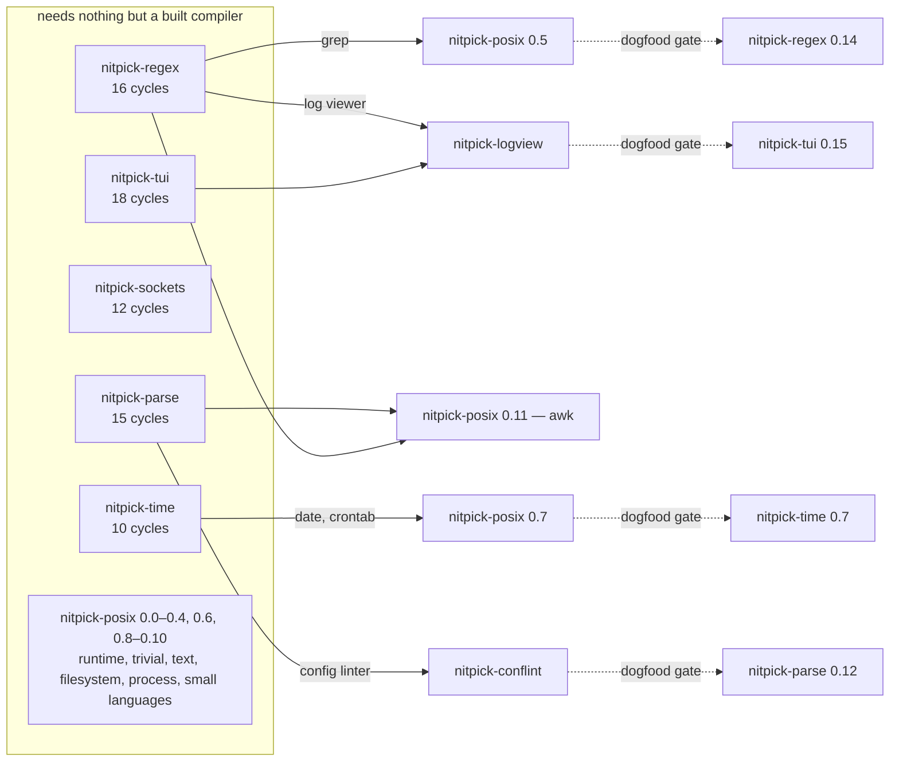

# Work streams — the dependency graph, and how to run three agents on it

The plan for **parallel implementation**, built before it is needed. It answers
three questions: what depends on what, which work can proceed at the same time
without collision, and how a stream claims work so two agents never touch one
repository.

The live state is [`BOARD.md`](BOARD.md). This file is the durable part.

---

## 1. The headline, measured rather than assumed

**The compiler gates almost none of this.** Everything each repository's plan
calls cycles 0.0 through roughly 0.15 — the probes, the harness, the storage
primitives, the device layers, the engines, the widgets, the utilities — needs
only a **built compiler**, which exists. Nothing waits on cycle 1.5 or 1.6.

What the compiler *does* gate, exhaustively:

| Compiler capability | What it unblocks | Where it bites |
|---|---|---|
| ~~**1.5.1 – 1.5.4** — the verification surface typed, `limit<Rules>`, contracts, `prove`~~ **cycle 1.5 — CLOSED 2026-09-25 (1.5.8d). `limit<Rules>` live since the `3d15ac9` pin, `requires` and `ensures` since `c3bdae2`; `prove` is accepted and checks nothing in a plain build** | turning each repository's `VERIFICATION.md` obligations from comments with property tests into real clauses | each library's **hardening** cycle, near its 1.0. Nothing earlier *(Corrected 2026-10-09, E2-5: the compiler no longer gates this row. The clauses are live and each one charges every consumer a `failsafe` arm (`LimitViolated`, `RequiresViolated`, `EnsuresViolated`). A `prove` obligation is judged only in a verified build, which no library has run yet, so it stays a comment until one does.)* |
| **O-N2** — `npkg` builds a library, `[dependencies]` resolves | retiring each Python harness; making cross-repo imports non-relative | **nothing**. Both are worked around by design, and the workaround is the plan |
| **O-N1** — `clone_exec` takes a signal mask | removing `ntui`'s unblock-around-spawn window | `ntui` 0.1.6 only, and it has a working answer already |
| **O-N5** — `npkg` builds many artifacts | `nitpick-posix`'s build | nothing; the harness does it |
| ~~**O-N6**~~ — a macro can splice a `pick` into a function body | **`nitpick-posix`'s entire shape** (PX-010) | **CLOSED 2026-09-03, negative.** It cannot, and a macro cannot be shared between modules at all. `failsafe` is generated (PX-100). The one real unknown is now a known |

The `O-N` ids above are the workbench registry's —
[`meta/OPEN_QUESTIONS.md`](meta/OPEN_QUESTIONS.md) §"For the compiler" —
because each repository numbers its own requests and the numbers collide.

**Rule W-1 — DISCHARGED 2026-09-03.** *O-N6 was answered before `nitpick-posix` was scheduled into a stream, which is what the rule asked for; the answer was negative and cost part of one day at cycle 0.0. Kept below as written, because the next repository with a load-bearing unknown gets the same treatment.* — O-N6 is answered before `nitpick-posix` is scheduled into a
stream.** It is one probe, it takes an afternoon, and a negative answer
replans a fourteen-cycle repository. Run it early and out of band.

---

## 2. The graph

*(Note 2026-10-16, E2-14: posix's `ROADMAP.md` gates 0.11 on 0.10 only, while its decision PX-008 makes `awk` a consumer of both `nparse` and `nregex`, as these edges draw. The edges stand; posix's plan owes the gate, or the reason for none.)*

**Rule W-2 — the libraries do not depend on each other.** `[dependencies]` is
empty everywhere by decision, and the only recorded overlaps (Unicode tables
between `ntui` and `nregex`; datetime scanning between `nparse` and `ntime`)
are *open questions*, not edges. Five of the six repositories can be worked in
any order, simultaneously.

**Rule W-3 — every cross-repository edge is a dogfood consumer, and every one
of them is mutual.** `nitpick-posix` 0.5 needs `nregex` finished; `nregex` 0.14
needs `grep` written and *used*. Neither closes alone. The dotted edges above
are that second half, and they are why a stream cannot simply run to the end of
its list.

---

## 3. The three streams

Chosen so that each owns whole repositories, no two share one, and the
cross-stream edges land where the streams naturally arrive at them.

| Stream | Repositories, in order | Size |
|---|---|---|
| **1 — text** | `nitpick-regex` → `nitpick-tui` → `nitpick-logview` | 34 cycles + an app |
| **2 — data** | `nitpick-time` → `nitpick-parse` → `nitpick-conflint` | 25 cycles + an app |
| **3 — system** | `nitpick-sockets` → `nitpick-posix` | 27 cycles |

**Why this partition and not another.** Three properties, in order of weight:

1. **`nitpick-posix` is the convergence point** — it consumes `nregex`,
   `ntime` and `nparse` — so it goes last in its stream, and the stream it is
   in should be the one whose *own* first item is smallest. `sockets` (12) is
   that item.
2. **The gated cycles arrive when their dependency is ready.** Stream 3 reaches
   `nitpick-posix` 0.5 (`grep`) at about unit 17, and stream 1 finishes
   `nregex` at unit 16. `nitpick-posix` 0.7 (`date`) lands at about unit 19,
   and stream 2 finishes `ntime` at unit 10 — comfortably early. `awk` at
   about unit 23 wants `nparse`, which stream 2 finishes at 25. That last one
   is tight and §5 says what to do about it.
3. **The recorded overlaps stay inside a stream where possible.** `nregex` and
   `ntui` both want Unicode tables and are both stream 1, so the second one
   inherits the first one's approach instead of inventing a second.

**Rule W-4 — sizes are estimates and the first completed cycle recalibrates
them.** Cycle counts are a poor proxy: `ntui` 0.11 (core widgets) is worth
several of `ntime` 0.2. After each stream closes its first cycle, the
orchestrator re-reads the partition against measured wall-clock and rebalances
`BOARD.md`. Pretending the initial split is right is how a stream ends up idle
for a week.

---

## 4. Running fewer than three

**Rule W-5 — the streams are ordered so that running only stream 1 is a
coherent plan.** This is deliberate: the number of concurrent agents is a dial,
not a constant, and the plan must degrade rather than require its full width.

| Width | What to run | What you get |
|---|---|---|
| **1** | stream 1, then 2, then 3 | the whole ecosystem, serially, in dependency order. Longest, simplest, and the right choice when attention is the scarce resource |
| **2** | streams 1 and 2 | the five libraries, with `nitpick-posix` and the apps after. No cross-stream waiting at all until the dogfood cycles |
| **3** | all three | fastest, and the only width where §3's timing analysis matters |

**Rule W-6 — a stream is never split across agents.** One agent owns a stream
for the duration of a session. Two agents in one repository is the failure the
compiler's own R2 forbids permanently, and a stream is the unit that makes that
enforceable.

---

## 5. The rules

**Rule W-7 — one writer per repository, always.** A stream claims a repository
in `BOARD.md` before touching it and releases it when the cycle closes. A
repository with no claim is nobody's. Enforced by the guard for sessions
started outside the repository (0.2.5).

*(Note 2026-10-16, E3-4: a tool repository is not claimed here and is its own manager's, which W-30 records. The Team seat's chains are claimed here for the review and merge, which W-29 records.)*

**Rule W-8 — the orchestrator owns `BOARD.md`.** Agents do not edit it. That
removes every merge conflict by construction and matches the compiler's
`ORCHESTRATION.md` R8, which gives the orchestrator assignment, integration,
record-keeping and escalation routing — and no code.

**Rule W-9 — a cross-stream gate is a hand-off, and it is scheduled.** When
stream 3 reaches `nitpick-posix` 0.5, it needs `nregex` *finished*, not
*in progress*. The orchestrator checks the board before releasing the claim. If
the dependency is not ready, the stream takes the next unblocked cycle in the
same repository rather than idling — `nitpick-posix` has nine ungated cycles
and they exist precisely for this.

**Rule W-10 — a mutual dogfood gate closes in one direction first.** Write the
consumer, use it, record the findings, *then* close the library's cycle with
those findings triaged. The library's cycle is gated on the program being
**used**, not on it compiling, so the order is forced and the board records
both halves separately.

**Rule W-11 — a compiler defect found in any stream stops that stream and is
escalated, never worked around.** The compiler's R6, and the reason applies
with more force here: a workaround buried in library code outlives the bug and
is indefensible at verification time.

**Rule W-12 — a red under parallel load is a stop sign, never a retry.** R5.
Every timing-shaped defect this ecosystem has found looked like flakiness
first.

**Rule W-13 — independently green is not green.** R3. Where two streams have
touched anything shared — the playbook, a registry, a workbench document — the
orchestrator merges and re-checks rather than collecting green branches.

**Rule W-14 — the probes are the cheapest possible risk reduction and they are
already written.** Every repository's `0.0.0.md` is execution-grade. Running
them before the compiler frees up converts six unknowns into six facts, and any
one of them coming back negative is worth knowing before a stream is committed
to a plan built on it. *(Note 2026-10-09, E2-5: the compiler is built, and `nitpick-regex` and `nitpick-time` have run their probes, so the rule now bears on `nitpick-tui`, `nitpick-parse`, `nitpick-sockets` and `nitpick-posix`.)*

**Rule W-15 — the unit of delegation is the subcycle.** One fresh worker per
subcycle; the claim covers the repository for the cycle; the handoff between
subcycles is the execution record. (`meta/roadmap/0.2/README.md` P-1)

**Rule W-16 — the workbench repositories have one writer: the orchestrator.**
A worker, planner, auditor or researcher writes nothing under `nitpick-libs/`
or `nitpick-apps/` roots. Findings for the playbook travel in the report and
the orchestrator lands them. The writer is named on the board's header
(`Workbench writer:`); a session that finds another named does not write
here. `BOARD.md` itself is the lock and is always writable: a session that
finds another writer named *and gone* takes the lock and records the
takeover in `RECORD.md`. Enforced by the guard (0.2.5). (P-2, P-19)

**Rule W-17 — workers commit to `main`.** Nothing is branched and nothing is
merged; one writer per repository makes both redundant. (P-3)

*(Note 2026-10-16, E3-4 and EC8: a chain from the Team seat works on a `team/` branch and is merged here by a fast-forward of `main`, which W-29 records. A worker dispatched from here still commits to `main`. A tool repository's sessions commit as its own `CLAUDE.md` says, which W-30 records.)*

**Rule W-18 — the toolchain is pinned.** The orchestrator copies `npkc` and
`npkrt.o` out of the compiler's `build/` into `.internal/toolchain/<commit>/`,
records the commit on the board, and passes the paths to every worker. A
worker never reads `../nitpick/build/` and never builds the compiler. A re-pin
happens between cycles, by the orchestrator, and is recorded. (P-4)

*(Note 2026-10-16, E3-4 and EC9: a re-pin has been taken with every claim at rest and a library mid-cycle, and each library then adopts the pin in a lettered subcycle, which W-31 records. A tool repository's sessions build their compilers in its own tree, which W-30 records.)*

**Rule W-19 — a claim is recoverable.** The board's in-flight table names the
subcycle, the agent label, the start time and the model for every claim. A
claim with no live agent in the current session is stale, and the orchestrate
skill's recovery procedure runs before any dispatch. (P-5)

**Rule W-20 — a report has one shape, in two places.** The worker's final
message and the subcycle's committed execution record both carry the REPORT
block the worker skill defines; `check_record.py` verifies the committed one.
(P-6)

**Rule W-21 — release needs a verifier.** Before a claim is released or a
subcycle is marked done on the board, a verifier re-runs the reference check,
the record check and the harness or probe commands on the committed tree.
Independently green is not green; reported green is not green either. (P-7)

**Rule W-22 — the audit precedes the close.** A cycle's last subcycle reports
READY-TO-CLOSE; the auditor runs and writes nothing; the orchestrator files the
report under `meta/audits/`; the close worker triages every finding. After
every third cycle close, an ecosystem-wide audit. (P-8)

**Rule W-23 — a stop stops its stream.** A compiler defect, a missing
decision, a wrong specification, a contested repository, a negative probe, or
an ambiguity stops the stream that found it and nothing else. Questions are
batched with a recommendation each and sent when every running stream is
stopped, the batch holds three, or four hours have passed. (P-11)

**Rule W-24 — width is an argument.** Default one; never more than one worker
per stream; helper agents do not count and never run two of a kind. (P-12)

**Rule W-25 — research has a shape.** One fetch may be inline; more goes to
the researcher agent, who never writes into a repository. The requesting
writer files the digest under `meta/research/` with the date checked; a
decision cites the digest; a security-sensitive digest is stale after ninety
days; language facts are never researched on the web. (P-14)

**Rule W-26 — repository creation is never delegated.** It is outward-facing
and it edits the registry, so the orchestrator or the author runs
`/npk:new-repo`. (P-18)

**Rule W-27 — an escalation states what the defect blocks, and stops there.**
Refines W-11 and W-23. When this workbench raises a defect against the
compiler it says plainly what is blocked, what is merely inconvenienced, and
what is unaffected — and it does **not** append "no schedule pressure
implied", which reads as modesty and is actually a withheld fact. The
sequencing is the author's and the compiler side's; the blocking status is
*ours*, because only the stream that hit the defect knows what it cannot do
without the fix. **Answered by the author 2026-09-03 (Q-9), confirming the
rule the compiler side works to: a defect a real program finds is fixed
before planned work.** The evidence that hedging costs something is O-N9 —
this workbench recommended it as conformance rather than a block, the author
overrode that, and the override cost nothing because the fix batched with
three others. Had the recommendation been followed, `src/fmt/` would have
been built on an unenforced escape rule.

---

**Rule W-28 — a committed `REPORT` block is immutable, and a sweep must say so
rather than look short.** Refines the append-only rule with the finer form
`PLAYBOOK.md` §6 already draws: **what may be amended depends on whether the
document records something that *happened*.** A `REPORT` block records what a
worker said on a date. It is evidence, not documentation, and correcting it in
place destroys the only record of what was believed at the time. **So a wrong
statement inside a committed REPORT block is corrected in a later `RECORD.md`
entry or in the document that supersedes it — never by editing the block.**

**The half that has bitten twice is the bookkeeping, not the principle.** A sweep
that finds six sites and edits five reads as *incomplete*, and the sixth looks
like an omission for as long as anyone remembers to explain it. **State the
denominator and the exemption together: "six sites, five edited, one inside a
committed REPORT block and corrected at `RECORD.md` <date> under W-28."** A count
that does not name its exemptions is the same defect this workbench keeps finding
in checks whose name is wider than their mechanism.

**Answered by the author 2026-09-06 (Q-1), ratifying the worker's own reasoning.**
It reached this table twice — a worker declined the edit and argued the case, a
second dispatch met the same question, and both left it open. Writing it down
costs one rule and stops a third dispatch re-deciding it from scratch.

**Rule W-29 — a chain from the Team seat works on a `team/` branch, and the
orchestrator reviews it and fast-forwards `main`.** Refines W-17, which still
holds for a worker dispatched from here. The Team seat is a second account
whose sessions work in `~/Team`, in clones of their own. Each side reads the
other's domain and never writes it, and `tools/guard_domains.py` enforces that
both ways. The Team seat's manager runs a chain on a subcycle (plan, plan
verifier, work, work verifier) on a `team/<repository>-<item>` branch in its
clone, pushed to GitHub. It never pushes `main` and never edits `BOARD.md`
(W-8). The orchestrator claims the repository for the merge (W-7), and for the
chain itself where the board says so. It reads the chain's reports,
spot-checks them against the fetched branch, fast-forwards the repository's
`main`, in this workbench's checkout, to the verified commit, pushes, and
releases the claim. A chain stops before a cycle's close, which stays the
orchestrator's. It also stops at a decision for the author, a re-pin, a
verifier failing twice on one point, or a compiler defect (W-11, W-23). A
chain's next subcycle starts on the same branch once the previous one has
reported CHAIN PASS. A cycle's close is dispatched only after its last
subcycle is merged. The procedure lives in the Team brief (gitignored, under
`.internal/team/`) and orchestrate §14. *Described 2026-10-16, from practice
the author approved 2026-10-15.*

**Rule W-30 — a tool repository has its own manager, and this workbench does
not claim, dispatch or write it.** Refines W-7, W-17 and W-18. A tool
repository, today `nitpick-fuzz`, is recorded on the board under *Outside the
streams — tools* and is not a stream. From 2026-10-15 it has a manager session
of its own, which owns its milestones and its merges. Diogenes' merges are
likewise its own manager's. Above the managers, management allocates each
account's usage and the credits. The orchestrator does not claim, dispatch or
write such a repository, so "a repository with no claim is nobody's" (W-7)
does not apply to it. A chain from the Team seat on a tool repository reports
to that repository's manager, not here, and W-29's review and merge are then
the manager's. What crosses goes by message and by git: a compiler landing
that moves a tool repository's programs is told to its manager, and its
findings reach the compiler seat from its manager with the orchestrator
copied. Where a tool repository orders its milestones as a gate (the fuzzer's:
a milestone starts only after the one before it is merged), the gate is that
repository's own. Its sessions follow its own `CLAUDE.md`, not this book's
worker rules: W-17's commit to `main` and W-18's "never builds the compiler"
bind the workers dispatched from here, and the fuzzer's sessions build their
compilers in its own `.work/` (`nitpick-fuzz/CLAUDE.md:27-28`). *Described
2026-10-16, from practice the author approved 2026-10-15.*

**Rule W-31 — a re-pin is taken with every claim at rest, and each library
adopts it in a lettered subcycle.** Refines W-18, which still holds for who
pins and records. A re-pin is taken by the orchestrator when no claim is in
flight (orchestrate skill §2, step 4), even with a library mid-cycle. It does
not wait for a cycle's end. Each library then adopts the new pin in a lettered
subcycle, for example regex 0.2.1a and time 0.3.2a for `7e91730`. That
subcycle is the first thing dispatched on the library at the new pin, and
nothing else is dispatched on it until it lands, since its harness may be red
at the new pin. The adoption carries the CI pin bump and the checks the
re-pin's landings owe that library, with an old-pin leg on the kept pin. The
procedure lives in the orchestrate skill (§2 step 4, §3) and in each cycle's
README, which names the lettered row. *Described 2026-10-16, from practice the
author approved 2026-10-15.*

---

## 6. What could start today

Six things need nothing that does not already exist, and each is roughly a day:

| Work | Why now |
|---|---|
| ~~**`nitpick-posix` 0.0.0 probe 02**~~ | ~~W-1. It gates a fourteen-cycle repository's shape and nothing else can be scheduled around it until it is answered~~ **Answered 2026-09-03, negative** *(Corrected 2026-10-09, E2-5: W-1 is DISCHARGED at line 33 above and O-N6 is closed negative in the table at line 27. Nothing is gated on this probe any more.)* |
| each library's **cycle 0.0 probes** | every one of them exists to find out whether the design is spellable, and a negative answer changes a specification. ~~Five repositories, five afternoons, and they are independent~~ They are independent *(Corrected 2026-10-09, E2-5: `nitpick-regex` and `nitpick-time` closed cycle 0.0 and are past cycle 0.1. `nitpick-tui`, `nitpick-parse` and `nitpick-sockets` still have theirs, each "0.0 execution-grade", and so does `nitpick-posix` beyond its probe 02: three libraries and the apps repository, not five afternoons.)* |
| **`nitpick-libs` O-N2 request** | raised with the compiler side. It blocks nothing but it has a long lead time |

*(Rule W-14 now stands in §5, after W-13. Moved 2026-10-09, the early ecosystem audit's E2-5: it was left here when cycle 0.2.0 appended W-15 onward after it.)*
